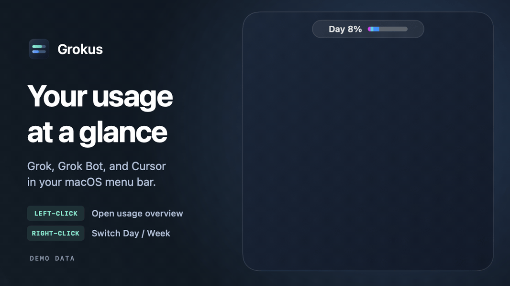

# Grokus



A macOS menu bar app for Grok Bot usage. After installation, left-click the menu bar meter and sign in to Cursor. Right-click the meter to switch between Day and Week. The app remembers the selected view and refreshes about once a minute while it runs.

The Week meter shows the share of the included pool used. The Day meter shows estimated usage against an even daily share of the pool plus unused budget from prior days. The overview’s daily columns are measured in percentage points of the weekly pool. Cursor provides a cumulative total, so Grokus estimates daily usage by sampling it. Usage before the first sample cannot always be assigned to a day. If TokenMon has saved Grok Bot daily history on this Mac, Grokus imports it automatically. Use the arrows on the daily chart to browse earlier weeks. When both apps recorded a day, Grokus uses the larger estimate to avoid counting the same usage twice.

Sign in to Grok to see your prepaid credit balance and the product breakdown for a shared weekly pool. Grokus uses changes between samples for daily colors. Usage without a recorded breakdown is gray.

## Install from source

Grokus requires macOS 14 or newer and the Xcode command line tools. If the tools are missing, run `xcode-select --install` and finish the installation first. Clone with a GitHub account that has access to this repository.

```sh
git clone https://github.com/pymmog/grok-mon.git grokus
cd grokus
./build.sh
open build/Grokus.app
```

The build script creates and signs the app locally. To keep it in Applications, quit Grokus and drag `build/Grokus.app` into Applications in Finder.

The Cursor usage integration follows [TokenMon](https://github.com/faulknerpearce/token_monitor) by Austin Faulkner-Pearce. Grokus uses its own WebKit session and local usage samples.
